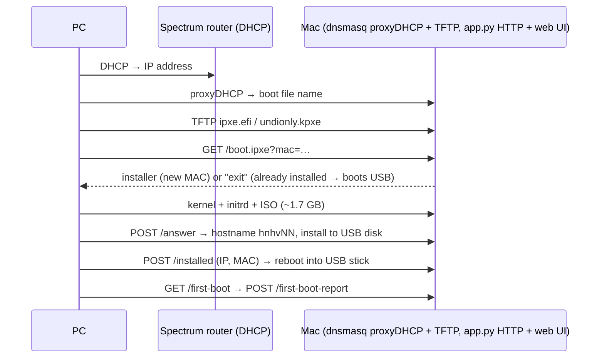

# Proxmox VE network install from this Mac

PXE-boot each PC, install Proxmox VE 9.2 unattended onto its USB stick, and turn its
internal drive into VM/container storage. Runs entirely from the Mac; the Spectrum
router is left untouched.



## What each node gets

| Item | Value |
|---|---|
| Hostname | `hnhv01`, `hnhv02`, … in install order (`<site><role><NN>`: homenet, hypervisor), FQDN `hnhv01.int.z7x.org`; set in `config.env` |
| OS disk | the USB disk (`ID_BUS=usb`), ext4, no swap, no data volume |
| IP | whatever the router's DHCP gave it during install, written as static config |
| root password | `secrets/root-password` (generated on first build) |
| root SSH keys | your SSH agent's keys (Secretive) + `secrets/automation_ed25519` for Ansible; refreshed on every `./build.sh` |
| VM/CT storage | `vmdata`: LVM-thin on the internal drive, if it is the only internal drive **and blank** |
| `local` storage (USB) | `iso,vztmpl,backup` only, so VM disks never land on the stick |
| USB wear | journal kept in RAM (lost on reboot), root mounted `noatime` |
| apt | enterprise repos disabled, `pve-no-subscription` enabled |

## Before you start

Per PC, in the firmware setup:
- Enable network boot (UEFI: "IPv4 PXE"; legacy BIOS works too).
- **Disable Secure Boot**: the iPXE build is unsigned.
- Plug in **only** its own USB stick (the installer wipes the first USB disk it finds).
- Wired Ethernet to the router; PXE does not work over Wi-Fi.
- RAM: the installer runs entirely from RAM. Tested with 6 GB.

On the Mac: Docker (OrbStack), Homebrew `dnsmasq`, Python 3, `uv` (`brew install uv`). In the Spectrum app,
reserve the Mac's IP (`192.168.1.10` at build time); it is baked into the boot files.

## Use

```sh
./build.sh      # once, and again if the Mac's IP / config.env / ISO changes (~1 min after first run)
./run.sh        # asks for your sudo password (dnsmasq needs ports 67/69/4011); Ctrl-C stops
```

Then on each PC: open the one-time boot menu (often F12/F11/Esc) and pick the network /
PXE IPv4 entry. Everything after that is unattended: the installer menu auto-selects
"Automated" after 10 s, installs, reboots, and the server hands the PC back to its USB
stick. Several PCs can install at once; each pulls ~1.7 GB over the Mac's Wi-Fi.

Open **http://localhost:8070/** for the live dashboard: each node's status (installing →
first boot → ready), IP, MAC, model, first-boot report, download progress, and an
activity log (dnsmasq, installer, downloads) with filters. **Reserve each node's IP in
the My Spectrum app** (Advanced settings → IP reservations) right away — the dashboard
has a copy button for each node's IP and MAC. The router's DHCP pool is all of
`.2–.254` and cannot be changed, so an unreserved node IP can be handed to another
device later.

Web UI: `https://<node-ip>:8006`, user `root`, realm PAM, password from
`secrets/root-password` (the dashboard has buttons to open this and to copy the
password).

## Day-2

```sh
python3 server/core.py list           # hosts, status, IPs, MACs
python3 server/core.py forget hnhv03  # next PXE boot of that PC reinstalls it (wipes its USB stick)
```

The dashboard's Reinstall button does the same as `forget`.

- Internal drive skipped (not blank or several drives)? The first-boot report says so.
  On the node: `wipefs -a /dev/sdX && pxe-first-boot` (destroys that drive's data).
- Cluster: on `hnhv01` run `pvecm create homelab`, then join the rest via Datacenter →
  Cluster → Join. Every node uses the same storage ID `vmdata`, so the cluster-wide
  storage config works unchanged.
- Installer failure: the PC drops to a shell. Logs: `/tmp/fetch_answer.log`,
  `/tmp/auto_installer`, `/tmp/install-low-level-start-session.log`.
- PC never gets a boot file: check the dashboard's Activity log filtered to `dnsmasq`
  (run.sh output also shows the `dnsmasq` lines, e.g. `log-dhcp`).

## Layout

| Path | Purpose |
|---|---|
| `config.env` | site settings (interface, hostname prefix, timezone, ISO) |
| `build.sh`, `builder/` | builds `out/` in a Debian container: prepared PXE installer, iPXE, password hash |
| `run.sh` | writes `out/dnsmasq.conf`, starts `server/app.py` (which runs dnsmasq) |
| `server/app.py` | installer endpoints + web UI + dnsmasq supervisor; uv inline script (Litestar, Jinja2, embedded Granian) |
| `server/core.py` | stdlib-only answer-file logic and CLI; state in `state/hosts.json` |
| `server/templates/`, `server/static/` | web UI templates and assets (Basecoat UI via CDN, no build step) |
| `server/first-boot.sh` | runs once on each node (installed as `/usr/local/sbin/pxe-first-boot`) |
| `secrets/` | root password + hash (mode 600) |
| `cache/` | ISO and iPXE source |
